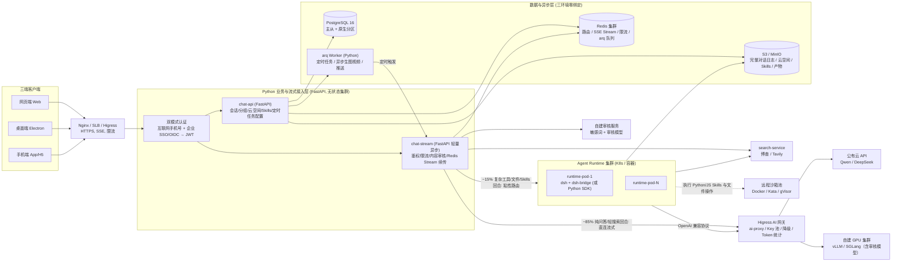
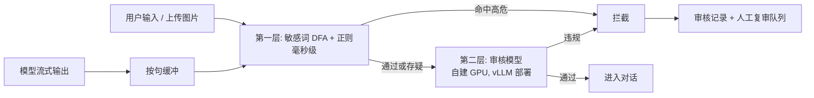

# 个人工作助手多端服务端设计规格（FastAPI + DeepSeek Harness）

**日期：** 2026-11-16
**状态：** 方案已定稿；2026-11-17 补充技术选型定稿（第 8 节），配套功能需求见 [2026-11-17-personal-assistant-functional-requirements.md](./2026-11-17-personal-assistant-functional-requirements.md)（文档阶段，暂未写代码）
**产品定位：** 面向大量用户（17 万规模基线）的 **AI 个人工作助手**，向 **Web / Desktop / Mobile** 三端提供统一服务端接口（前端三端暂不出方案）。

> **文档关系说明**：本文档汇总并定稿了此前的技术选型讨论（替代早期的 Java/TypeScript 草稿），最终确定为：**全 Python 业务与流式接入层（FastAPI） + 快慢分离 + 工作模式采用 DeepSeek Harness（`dsh`）+ 远程容器沙箱**。

---

## 1. 核心需求与能力映射（统一对话，不区分日常/工作）

产品采用 **Grok Bot 式统一对话工作台**：用户不需要手动切换“日常”和“工作”两个空间，**同一个对话里可以做所有事**——闲聊、联网检索、深度分析、上传文件、生成图表/PPT、执行 Python/JS Skills、触发定时早报，所有产物自动沉淀进右侧资产库。

| 能力域 | 用户能力 | 服务端实现 |
|---|---|---|
| **统一对话 & 多 Bot** | 默认全能助手 + 可创建多个专长 Bot，一个对话干所有事 | `ai_bot` 绑定人设/默认模型/Skills；单会话统一上下文，**按回合自动判断**走轻量直连还是 `dsh` 引擎 |
| **Library（资产库）** | 按 `All / Media / Files` 分类查看对话与定时任务产出的图表、图片、文件（Today / This week / Older） | 统一 `session_artifact` 索引表 + S3/MinIO 存储，按时间分组分页 |
| **Activity（动态）** | 查看定时任务执行动态、后台长任务进度与通知 | `arq` 任务日志 + 站内消息/推送状态流 |
| **对话管理与分享** | 新建会话、置顶、分组、搜索、一键 Share 公开/团队链接 | 会话 CRUD、分享快照与过期控制 |
| **定时任务** | Cron 定时跑早报/监控/提醒，结果自动落入指定 Bot 对话 | `arq` / Redis 分布式定时调度 + App 推送/站内信 |
| **模型选择** | 按会话或 Bot 切换模型 | 模型目录（支持按用户/企业组织过滤可见模型） |
| **用户上传 Skills** | 上传自定义工作流与 `Python / JS` 脚本 | S3 隔离存储 + `dsh` 自定义 `skill-remote` Provider + 隔离容器执行 |

---

## 2. 总体架构图

---

## 3. 为什么这样组合（技术栈与分工）

1. **全 Python 控制面（贴合团队主力语言）**：
   - `chat-api`、`chat-stream`、`arq Worker` 全部采用 **Python 3.11+ + FastAPI + SQLAlchemy 2.0 / `asyncpg` + Pydantic v2**。
   - **关键性能约束**：`chat-stream` 进程保持轻量（只依赖 `httpx` + `redis`），不引入重型 Agent 包，配合多 worker 与前置 Nginx，低成本扛住 17 万用户峰值（~1.7 万在线 / ~5,000 并发 SSE）。

2. **按回合自动快慢路由（用户无感，始终在同一个对话）**：
   - **快路径回合（~85% 流量）**：当前提问不涉及文件、代码、Skills 或多步工具时，FastAPI 从 Redis/PG 取最近上下文直连 LLM 网关流式输出，**不经过 `dsh`**，零容器常驻开销、首字延迟最低。
   - **Agent 回合（~15% 流量）**：当前提问附带了文件、命中了 Skills / MCP、或需要图表/PPT/代码执行时，服务端自动把同一份会话历史路由给 **DeepSeek Harness（`dsh`）** 执行，复用其 `skill-office`、Skills、MCP、上下文压缩与子 Agent 能力。
   - 对用户而言**没有“切换空间”的概念**，下一轮继续闲聊又自动切回快路径。

3. **`dsh` 与 Python 的对接及多 Pod 改造**：
   - `dsh` 官方提供 **Python SDK（`deepseek-harness-sdk` + 内置二进制包 `deepseek-harness-runtime-bin`）** 与 **JSON-RPC / ACP 协议**；生产多 Pod 部署建议在工作模式 Pod 内以 **轻量 HTTP+SSE Bridge 插件（`dsh-bridge`）** 暴露内网接口，由 Python `chat-stream` 按 `sessionId` 做 Redis 粘性路由。
   - **无状态与冷恢复**：替换 `dsh` 本地 JSONL 写入为“本地热缓存 + 回合结束增量上传 S3/MinIO”，30 分钟无交互自动驱逐内存；Pod 宕机或缩容后，新 Pod 自动从 S3 恢复上下文。

---

## 4. 关键能力专题设计

### 4.1 用户上传 Skills（支持 Python / JS 执行）
- **上传与校验**：`chat-api` 接收 Skill 包（`SKILL.md` + `scripts/*.py|js` + `references/`），校验包大小、禁用软链与路径穿越后存 S3/MinIO，并在 PG `user_skill` 表记录归属（个人私有 / 企业组织 / 平台公共）。
- **动态加载**：在 `dsh-bridge` 实现 `skill-remote` 注册到 `ctx.skills`，只向当前用户注入其有权限的 Skills。
- **隔离执行**：`dsh` 原生本地沙箱不隔离读取，**工作模式必须禁用宿主机文件/命令工具**，改为通过 `remote-sandbox`（仿照 `packages/ssh/` 接管 `fs + subprocess + sandbox`）将请求发往独立沙箱容器（预装 Python 3.11+、Node 24 与常用库），将 `scripts/` 只读挂载进去执行，限制 CPU/内存/超时并默认禁止公网访问。

### 4.2 双用户体系（互联网 + 企业内部）
- **`sys_user`**：包含 `user_type`（`internet` / `enterprise`）与 `org_id`。
- **认证与合规**：互联网用户走手机号验证码登录，强制经过输入/输出内容安全审核（流式按句缓冲）与合规留存；企业用户走 OIDC/OAuth2 对接现有 SSO，按 `org_id` 隔离数据、Skills 与模型可见性（如涉密企业仅可见内网 GPU 模型）。

### 4.3 模型网关（Higress AI 网关，2026-11-17 定稿）
- 采用 **Higress AI 网关**（Envoy 内核）对内暴露统一 OpenAI 兼容 `/v1/chat/completions`，`ai-proxy` 插件按模型名路由到公有云 API 或自建 vLLM/SGLang；Key 池轮询、供应商故障自动摘除与恢复、`ai-statistics` 统计 Token / 首字延迟。详见第 8.2 节。

### 4.4 断线续传、多端同步与 7×24 事件驱动模式
- **SSE 统一协议**：`meta` / `delta` / `thinking` / `tool` / `source` / `artifact` / `done` / `error`，每条事件带递增 `id` 写入 Redis Stream（保留 10 分钟），客户端通过 `GET /api/chat/stream/resume?sessionId=&lastEventId=` 断线续传或实现“PC 发起、手机实时看”。
- **7×24 小时事件驱动型 Agent（Router + Worker 分离）**：借鉴 `dsh-superagent-prototype` 的 Router/Worker 分离思想，由轻量的 `arq` Worker / 事件网关常驻接收定时（Cron）、邮件/日历回调、监控变化、IM 消息等外部事件，完成**去重、合并与权限准入**后派发给隔离的 `dsh-bridge` + 远程沙箱执行，敏感外发操作仍走 `confirm` 人工确认门禁，结果自动落入对应 Bot 会话并推送三端。

---

## 5. 数据模型与三环境部署

### 5.1 存储选型（PostgreSQL 16 + Redis + S3）
- **PostgreSQL 16**：使用原生声明式分区，省去外部 Sharding 中间件：
  - `chat_session`（按 `user_id` HASH 分 16 区）
  - `chat_message`（索引与预览摘要，按 `created_at` 按月 RANGE 分区；完整事件日志存 S3/MinIO）
  - 其余表：`sys_user`、`chat_group`、`chat_feedback`、`chat_share`、`ai_model`、`ai_mode`、`user_skill`、`user_file`、`chat_schedule_task`、`chat_schedule_log`、`user_quota`。
- **三环境可移植（K8s / 公有云 / 本地机房）**：不绑定云厂商专有 PaaS，对象存储统一走 S3 协议（云上 OSS/COS/S3，本地 MinIO），沙箱层在 K8s 用 Kata/gVisor，本地机房降级为 Docker Rootless + Seccomp；交付标准 **Helm Chart** 与 **Docker Compose**。

### 5.2 17 万用户资源估算（快慢分离后）
- 基线：17 万注册用户，峰值 ~1.7 万在线，~5,000 并发流（约 4,250 日常流 + 750 工作流）。
- 估算配置：
  - `chat-api` + `chat-stream`（FastAPI）：各 4 个 Pod（2C4G）
  - `arq Worker`：2–3 个 Pod（2C4G）
  - `dsh` 工作模式 Runtime：8–12 个 Pod（2C4G / 4C8G，HPA 弹性）
  - 远程沙箱池：预热 30–50 个轻量容器，峰值弹性至 ~300–500 个
  - PostgreSQL 16 主从（16C64G）+ Redis 3 主 3 从 + MinIO/OSS

---

## 6. 演进与可替换性边界

`dsh` 目前处于 developer preview，落地时强制守住 3 条边界，确保未来可平滑升级或整体替换为 AgentScope / 自研引擎：
1. **协议隔离**：Python 业务层与三端只认自研 REST + 统一 SSE 协议，不透传 `dsh` 内部事件结构。
2. **数据隔离**：历史对话按标准通用 JSON（`role / content / tool_calls / attachments`）存于自有 PG + S3，由 `dsh-bridge` 适配读取，不锁死在框架私有格式。
3. **代码边界**：不修改 `vendor/deepseek-harness-master` 上游源码，所有扩展封装在独立插件层；升级或替换时通过工作模式 Pod 灰度切流验证。

---

## 7. 三端产品功能矩阵与端云分工

### 7.1 三端共享核心功能（Web / Desktop / Mobile）

| 模块 | 功能点 | 服务端支撑 |
|---|---|---|
| 统一对话与多 Bot | 默认全能助手 + 可建多个专长 Bot、新对话、分组、置顶、搜索、多端同步 | `ai_bot` 配置 + PG 元数据 + Redis Stream 跨端实时订阅与断点续传 |
| 增强对话体验 | 流式输出、表格/图表卡片、停止生成、重问、点赞、Share 分享、引用来源 | SSE 统一事件协议、反馈/分享快照接口、搜索引用聚合 |
| **Library 资产库** | 按 `All / Media / Files` 分类，按 `Today / This week / Older` 展示图表、图片、文档产物 | `session_artifact` 统一索引 + S3/MinIO 存储 + 预签名预览/下载 |
| **Activity 动态** | 定时早报/监控任务执行记录、长任务进度、异常提醒 | `arq` 执行日志 + 站内信 / App Push |
| Skills 技能中心 | 内置技能、用户上传自定义 Skills（`SKILL.md` + `Python/JS` 脚本） | S3 归档 + `skill-remote` 动态加载 + 远程沙箱隔离执行 |
| 定时任务 | Cron 定时执行并自动写入对应 Bot 对话 | `arq` 周期调度 + 站内信 / App Push |

### 7.2 桌面端专属能力（Electron / PC，侧重生产力）

| 功能 | 端侧实现 | 服务端配合 |
|---|---|---|
| 全局快捷键 / 悬浮球 / 划词助手 | 系统级热键、选区监听、迷你浮窗 | 复用快路径短问答接口，低延迟返回 |
| 截屏提问 | 系统截图框选 | 图片直传多模态模型或 S3 临时凭证 |
| 本地目录授权挂载 | 授权本地文件夹、可选内嵌本地 `dsh` 执行本地文件整理 | 会话历史与元数据同步回云端 PG/S3，实现多端可查 |
| 会议录音转写与纪要 | 本地系统音频采集 | 音频上传 / ASR 转写接口 + 工作助理提炼纪要与待办 |

### 7.3 移动端专属能力（iOS / Android / 小程序，侧重随时随地与触达）

| 功能 | 端侧实现 | 服务端配合 |
|---|---|---|
| 语音输入 / 通话 / 播报 | 端侧录音与播放器 | ASR 语音转文字 + TTS 语音合成接口 |
| 拍照识图 / 文档扫描 | 相机拍照与边缘裁剪 | 多模态识别 + 结构化提取存进个人云空间 |
| 系统推送与快捷入口 | App Push 通道、桌面 Widget、系统分享菜单接收外部文章/文件 | 定时任务 / 长任务（PPT、生视频）完成后触发 Push，附直达会话链接 |
| 弱网 / 切后台续传 | 记录本地最新事件 ID | `GET /api/chat/stream/resume` 从 Redis Stream 补发遗漏片段 |

---

## 8. 技术选型定稿（2026-11-17）

### 8.1 全栈选型总表

| 层 | 选型 | 状态 |
|---|---|---|
| 入口网关 | Higress（南北向 Ingress：HTTPS / SSE / 限流） | 定稿 |
| 模型网关 | **Higress AI 网关**（独立部署实例，仅内网访问） | 定稿 |
| 业务 API / 流式接入 | Python 3.11 + FastAPI + Pydantic v2 + SQLAlchemy 2.0（asyncpg） | 定稿 |
| 异步任务 | arq（Redis） | 定稿 |
| Agent 引擎 | DeepSeek Harness（`dsh`，Node ≥ 24.9）+ 自研 `dsh-bridge` 插件 | 定稿 |
| 数据 | PostgreSQL 16 + **pgvector** / Redis 集群 / S3·MinIO | 定稿 |
| 联网搜索 | **博查（中文）+ Tavily（英文/海外）**，封装为 `search-service` | 定稿 |
| 内容审核 | **自建审核服务**（敏感词库 + 自部署审核模型 + 人工复审） | 定稿 |
| 可观测性 | **OpenTelemetry + Prometheus / Grafana**；模型调用链路 **Langfuse**（自托管） | 定稿 |
| 管理后台前端 | **Vue 3 + Element Plus** | 定稿 |
| 桌面端 | **Electron** | 定稿 |
| 手机端 | **Flutter**（iOS / Android） | 定稿 |
| 用户 Web 端前端 | **Vue 3**（与管理后台同栈，Electron 直接复用同一套代码） | 定稿 |
| 日志 | **Loki**（接入同一 Grafana） | 定稿 |

### 8.2 Higress AI 网关的职责边界

**交给 Higress 的：**
- `ai-proxy`：协议适配与按模型名路由（DeepSeek / Qwen / 自建 vLLM 等）。
- 供应商级容错：Key 池轮询，单 Key / 单供应商连续异常自动摘除、恢复后自动加回。
- `ai-token-ratelimit`：按用户 ID（请求头）做 Token 级防刷限流。
- `ai-statistics`：Token、首字延迟、耗时等指标，输出到 Prometheus 和链路追踪。
- 配置热更新：基于 xDS 动态下发，改配置不重启、不断开正在进行的 SSE 流。

**仍留在 Python 业务层的（不交给 Higress）：**

| 能力 | 原因 |
|---|---|
| 模型管理的"唯一数据源" | 后台模型管理页（功能文档 M18）写 PG `ai_provider` / `ai_model`，再由**同步任务调用 Higress Console API**下发；Higress 只是执行端。API Key 在 PG 中加密存储，下发到 Higress 时写入 K8s Secret |
| 积分计费 | Higress 的 `ai-quota` 是"按消费者扣 Token 余额"，与我们"多积分桶 + 模型倍率 + 工具消耗 + 按回合幂等结算"的规则不匹配。做法：每次调用带 `X-Turn-Id` / `X-User-Id` 请求头，业务层从响应 `usage` 字段汇总后按回合结算；Higress 的统计数据只用于**对账** |
| 模型级降级（换模型） | 需要在前端提示"已切换到 xxx"、并按新模型倍率计费，所以由业务层决定；Higress 只负责同一模型下的供应商切换 |
| 内容审核 | 自建审核需按用户类型分级、流式按句缓冲、写审核记录，放在 `chat-stream` 统一处理（见 8.4） |

> 流式调用必须开启 `stream_options.include_usage`，否则拿不到准确的 Token 用量。

### 8.3 联网搜索（search-service）

- 独立的轻量 Python 服务，统一接口 `POST /search`，内部适配博查与 Tavily：中文查询默认博查，英文/海外查询走 Tavily，任意一家失败自动切到另一家。
- **两条路径共用**：快路径的"轻搜索"回合由 `chat-stream` 直接调用（搜索后把结果交给模型回答，不进 `dsh`）；Agent 回合中 `dsh` 通过 MCP 工具调用同一服务。
- 搜索 API Key、默认供应商、每次搜索的积分单价都在管理后台配置。
- 结果缓存在 Redis（相同查询短时复用，节省费用），返回结果统一转成 `source` 事件，供前端展示引用卡片。

### 8.4 自建内容审核

- **单点接入**：快路径和 Agent 路径的输出最终都经过 `chat-stream`，所以审核只在这里做一次，不用在 `dsh` 内重复实现。
- **审核模型**：基于开源安全审核模型（如 Qwen3Guard 等）做私有数据微调，与业务模型一样部署在自建 GPU 上、经 Higress 调用；图片审核需要单独的多模态审核模型。
- **分级策略**：互联网用户强制双层审核；企业用户可按组织策略降级为仅敏感词。
- **持续迭代**：后台提供敏感词库管理、拦截记录、误判申诉与人工复审；人工复审结果回流为训练样本。

> [!WARNING]
> 面向国内 C 端提供生成式 AI 服务需完成算法备案和安全评估，监管对审核能力（关键词库规模、拒答测试题通过率等）有具体指标。自建方案从零起步时准确率有爬坡期，建议在上线前预留专门的评测与调优时间，并准备好备案材料所需的审核能力说明。

### 8.5 可观测性

| 维度 | 工具 | 内容 |
|---|---|---|
| 链路追踪 | OpenTelemetry | `trace_id` 贯穿 Higress → `chat-stream` → `dsh-bridge` → Higress AI 网关 → 模型；`dsh` 自带 `telemetry` 包，在 `dsh-bridge` 中接入同一 OTel Collector |
| 指标 | Prometheus + Grafana | 服务 QPS / 错误率 / SSE 并发 / 队列堆积；Higress `ai-statistics` 的 Token 与首字延迟；沙箱池水位 |
| 模型调用链路 | Langfuse（自托管） | 每个回合一条 Trace：路由判定、每次模型调用（Prompt、输出、Token、耗时）、工具调用；用于 Prompt 调优与效果评估 |
| 日志 | Loki | 结构化 JSON 日志，带 `trace_id` / `user_id` / `turn_id`；在 Grafana 中可从指标、链路一键跳转到对应日志 |

**Langfuse 注意事项：**
- 自托管 v3 需要 ClickHouse + PostgreSQL + Redis + S3，需单独纳入资源估算（ClickHouse 建议 8C32G 起）。
- Langfuse 会保存完整 Prompt 和回复，属于用户隐私数据：入库前对手机号、身份证等做脱敏；设置保留期（如 30 天）；仅限少数人员访问；"临时对话"不上报内容，只上报指标。
- 17 万用户规模下全量上报成本高，建议**按比例采样**（如 10%），报错、点踩、Agent 回合则全量上报。

### 8.6 前端三端

| 端 | 技术 | 说明 |
|---|---|---|
| 管理后台 | Vue 3 + Element Plus + Vite + Pinia | 运营后台与企业管理后台同一套代码，按角色显示菜单 |
| 用户 Web 端 | Vue 3 + Vite + Pinia | 与管理后台共享组件库、接口封装、SSE 客户端（UI 组件库按设计稿另定，Element Plus 偏后台风格） |
| 桌面端 | Electron | 渲染层直接复用用户 Web 端代码；主进程负责全局快捷键、划词、截屏、本地目录授权、系统托盘 |
| 手机端 | Flutter | 独立代码；SSE 客户端与断线续传需按统一协议自行实现；推送接入 APNs + 国内厂商通道（或个推 / 极光等聚合推送） |

> 选 Flutter 意味着**小程序端无法复用**移动端代码；如后续需要微信小程序，需另起一套（如 uni-app），或用 H5 承载。
