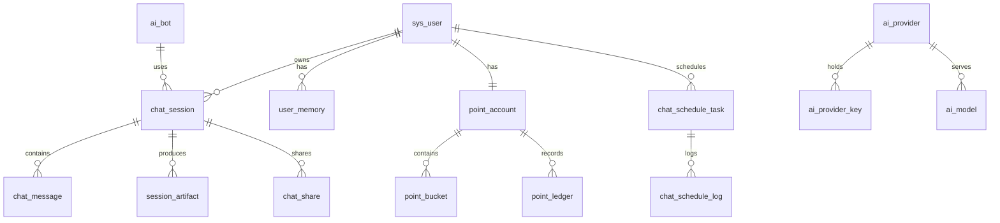

# 个人工作助手 · 数据模型设计（PostgreSQL 16 + pgvector / Redis / S3）

**日期：** 2026-11-17
**状态：** 草案 v1（仅设计，暂不写代码）
**前置文档：**
- [2026-11-16-personal-assistant-server-design.md](./2026-11-16-personal-assistant-server-design.md)
- [2026-11-17-personal-assistant-functional-requirements.md](./2026-11-17-personal-assistant-functional-requirements.md)

---

## 1. 存储分层职责

| 存储 | 放什么 | 不放什么 |
|---|---|---|
| **PostgreSQL 16 + pgvector** | 账号、模型配置、会话与消息树索引、记忆条目与向量、文件/产物元数据、定时任务、积分账户与流水、审核/审计日志 | 大文件二进制、完整工具调用大 JSON（放 S3）、高频短暂状态（放 Redis） |
| **Redis 集群** | SSE 断线续传 Stream（保留 10 分钟）、会话并发锁、短信验证码/JWT 黑名单、搜索结果缓存、Higress 模型缓存 | 持久化账本（积分最终以 PG 为准） |
| **S3 / MinIO** | 对话完整事件日志（冷恢复用）、用户上传文件、Agent 生成产物（PPT/图表/图片）、用户上传 Skill 包 | 结构化查询索引 |

> **全局约定**：主键统一用 `BIGINT`（雪花 ID / TSID，时间有序）；时间字段统一 `TIMESTAMPTZ`；用户侧核心表支持逻辑删除 `deleted_at TIMESTAMPTZ NULL`。

---

## 2. 核心 ER 关系概览

---

## 3. PostgreSQL 表结构设计

### 3.1 账号与权限（M1 / M16）

| 表名 | 关键字段 | 说明 |
|---|---|---|
| `sys_user` | `id`, `phone` (加密+hash索引), `nickname`, `avatar_url`, `user_type` (`internet`/`enterprise`), `org_id`, `custom_instructions` (TEXT), `memory_enabled` (BOOL), `status` (`active`/`banned`/`deleting`), `delete_at` (冷静期截止), `created_at` | C 端手机号登录；`delete_at` 到期后由定时任务物理清理 |
| `admin_user` | `id`, `username`, `password_hash`, `totp_secret` (加密), `role` (`super_admin`), `status`, `last_login_at` | 与 C 端用户完全隔离，强制二次验证（2FA） |
| `sys_org` *(V1)* | `id`, `name`, `sso_config` (JSONB), `allowed_models` (TEXT[]), `moderation_level`, `created_at` | 企业组织隔离与 SSO 配置 |

---

### 3.2 模型管理与 Bot（M3 / M18）

| 表名 | 关键字段 | 说明 |
|---|---|---|
| `ai_provider` | `id`, `name`, `provider_type` (`cloud`/`vllm`/`sglang`), `protocol` (`openai`/`anthropic`), `base_url`, `timeout_ms`, `rpm_limit`, `is_enabled`, `updated_at` | 管理员在后台配置；变更后异步同步至 Higress |
| `ai_provider_key` | `id`, `provider_id`, `key_ciphertext` (AES-GCM), `key_mask` (`sk-****9a21`), `weight`, `is_enabled`, `fail_count` | 不向前端回传明文；同步 Higress 时写入 K8s Secret |
| `ai_model` | `id`, `model_code` (UNIQUE), `provider_id`, `upstream_model`, `display_name`, `capabilities` (TEXT[]: `vision`/`reasoning`/`tool`/`long_ctx`), `context_length`, `max_output`, `rate_in`, `rate_cache`, `rate_out` (NUMERIC), `fallback_model_code`, `visible_scope` (`all`/`internet`/`org`), `status` (`online`/`canary`/`offline`), `canary_ratio`, `sort_order` | 业务层只引用 `model_code`；下线时按 `fallback_model_code` 平滑切换 |
| `ai_model_binding` | `purpose` (PK: `fast_chat`/`agent_chat`/`summary`/`memory_extract`/`router`/`embedding`/`vision`/`moderation`), `model_code`, `updated_at` | 系统内部各用途的模型绑定 |
| `ai_bot` | `id`, `owner_id` (NULL=平台默认), `name`, `avatar`, `system_prompt`, `welcome_msg`, `default_model_code`, `skill_ids` (BIGINT[]), `is_builtin`, `created_at` | 去掉原草稿的 `ai_mode` 表，统一由 `ai_bot` + 按回合快慢路由承载 |

---

### 3.3 统一对话与消息树（M2 / D7）

| 表名 | 关键字段 | 说明 |
|---|---|---|
| `chat_group` | `id`, `user_id`, `name`, `sort_order`, `created_at` | 侧边栏分组 |
| `chat_session` | `id`, `user_id`, `bot_id`, `group_id`, `title`, `summary` (TEXT), `model_code`, `is_pinned`, `is_temporary` (BOOL 无痕), `active_leaf_msg_id`, `last_msg_at`, `deleted_at` | **按 `user_id` HASH 分 16 区**；`active_leaf_msg_id` 指向当前展示分支的最后一条消息 |
| `chat_message` | `id`, `session_id`, `parent_id` (NULL=首条), `turn_id` (UUID), `role` (`user`/`assistant`/`tool`), `content` (TEXT 预览), `route_type` (`fast`/`agent`), `model_code`, `status` (`streaming`/`done`/`stopped`/`error`), `point_cost` (INT), `s3_event_key` (完整过程指针), `created_at` | **按 `created_at` 按月 RANGE 分区**；`parent_id` 构成消息树，MVP 即支持编辑重发保留分支 |
| `chat_feedback` | `id`, `user_id`, `message_id`, `rating` (`up`/`down`), `reason`, `created_at` | 点踩原因直接驱动 Langfuse 采样与调优 |
| `chat_share` | `id`, `share_token` (UNIQUE), `session_id`, `user_id`, `snapshot_s3_key`, `expire_at`, `is_revoked`, `created_at` | 分享快照，可随时撤销或运营下架 |

---

### 3.4 自动记忆（M4 / D2 / D10）

| 表名 | 关键字段 | 说明 |
|---|---|---|
| `user_memory` | `id`, `user_id`, `content` (TEXT), `category` (`profile`/`preference`/`fact`), `source_turn_id`, `embedding` (`vector(1536)`), `status` (`active`/`undone`/`deleted`), `created_at`, `updated_at` | 建 HNSW 向量索引（按 `user_id` 过滤）；用户点“撤销”置 `undone`，点“恢复”改回 `active` |

---

### 3.5 文件、产物与 Library（M5 / M9）

> 统一口径：`user_file` = 用户上传文件；`session_artifact` = AI 产出物；Library 界面展示二者的合并视图（按 `All / Media / Files` 与时间分组）。

| 表名 | 关键字段 | 说明 |
|---|---|---|
| `user_file` | `id`, `user_id`, `session_id`, `file_name`, `mime_type`, `file_size`, `s3_key`, `parse_status`, `deleted_at`, `created_at` | 会话内附件与个人文件空间 |
| `session_artifact` | `id`, `user_id`, `session_id`, `message_id`, `title`, `category` (`media`/`file`), `mime_type`, `file_size`, `s3_key`, `version` (INT), `deleted_at`, `created_at` | Agent 生成的 PPT、图表、图片、文档 |
| `knowledge_base` *(V1)* | `id`, `user_id`, `org_id`, `name`, `created_at` | 持久知识库（V1） |
| `kb_chunk` *(V1)* | `id`, `kb_id`, `doc_id`, `content`, `embedding` (`vector(1536)`) | 知识库切片向量 |

---

### 3.6 提醒与定时任务（M10 / M11）

| 表名 | 关键字段 | 说明 |
|---|---|---|
| `chat_schedule_task` | `id`, `user_id`, `bot_id`, `target_session_id` (固定早报会话), `title`, `prompt`, `cron_expr` (NULL=一次性提醒), `next_run_at`, `notify_channels` (TEXT[]: `inbox`/`push`), `fail_streak` (INT), `status` (`active`/`paused`/`auto_paused`), `created_at` | 连续失败 N 次自动置 `auto_paused` 并通知用户 |
| `chat_schedule_log` | `id`, `task_id`, `turn_id`, `status` (`success`/`failed`/`skipped_no_points`), `error_msg`, `point_cost`, `started_at`, `finished_at` | 支撑 Activity 动态页 |
| `user_notification` | `id`, `user_id`, `type` (`schedule`/`task`/`system`), `title`, `body`, `target_url`, `is_read`, `created_at` | 站内信与推送记录 |

---

### 3.7 积分与预留计费（M14 / D8 / D9）

| 表名 | 关键字段 | 说明 |
|---|---|---|
| `point_account` | `user_id` (PK), `total_balance` (INT), `updated_at` | 冗余总余额用于快速门槛校验 |
| `point_bucket` | `id`, `user_id`, `bucket_type` (`daily_free`/`promo`/`org`/`paid`), `balance` (INT), `priority` (SMALLINT: 1~4), `expire_at`, `created_at` | 按 `priority` 升序 + `expire_at` 先到期先扣；每日免费桶次日清零刷新 |
| `point_ledger` | `id`, `user_id`, `turn_id` (UNIQUE 幂等), `delta` (INT), `balance_after`, `detail_json` (JSONB: 模型token/搜索/沙箱拆分), `created_at` | 不可变账本；`turn_id` 唯一约束保证绝不重复扣费 |
| `point_rule` | `rule_key` (PK: `daily_free_amount`/`search_cost`/`sandbox_10s_cost`/`image_cost`), `rule_value` (INT), `updated_at` | 后台“积分规则”配置页持久化 |
| `billing_plan` / `billing_order` / `billing_payment` *(P2 预留)* | 套餐编码/价格/积分包、订单号/状态、第三方支付流水 | 首版只建表不开发接口 |

---

### 3.8 Skills、安全审核与审计（M7 / M16 / M17）

| 表名 | 关键字段 | 说明 |
|---|---|---|
| `user_skill` | `id`, `owner_id`, `scope` (`private`/`org`/`public`), `name`, `s3_key`, `permissions` (JSONB: `net_domains`/`secrets`), `scan_status` (`pending`/`passed`/`rejected`), `review_status` (`none`/`approved`/`banned`), `version`, `created_at` | 默认 `private`；运营可置 `banned` 一键全局下架 |
| `moderation_log` | `id`, `user_id`, `turn_id`, `direction` (`input`/`output`), `hit_layer` (`dfa`/`guard_model`), `snippet`, `review_status` (`pending`/`false_positive`/`confirmed`), `reviewer_id`, `created_at` | 支撑后台审核队列与样本回流 |
| `audit_log` | `id`, `actor_type` (`admin`/`user`), `actor_id`, `action`, `target_type`, `target_id`, `diff_json` (JSONB, 密钥脱敏), `created_at` | 模型变更、敏感操作确认、封禁等全量审计 |

---

## 4. Redis Key 与 S3 目录规范

### Redis Key 设计
- `chat:stream:{session_id}`：Redis Stream（`MAXLEN ~500`, `EX 600`），存 `meta / delta / thinking / tool / memory / source / artifact / done` 事件，供断线续传与多端实时订阅。
- `chat:lock:{session_id}`：会话级分布式锁（`EX 120`），防两端同时发送消息乱序。
- `runtime:sticky:{session_id}`：记录工作回合粘性路由的 `dsh` Pod 地址（`EX 1800`）。
- `search:cache:{sha256(query)}`：联网搜索缓存（`EX 900`）。
- `auth:otp:{phone}` / `auth:rl:{phone}`：短信验证码与防刷限流。

### S3 / MinIO 目录规范
- `sessions/{user_id}/{session_id}/events.jsonl`：`dsh` 冷恢复上下文与完整工具日志。
- `uploads/{user_id}/{yyyy-mm}/{file_id}_{filename}`：用户上传附件。
- `artifacts/{user_id}/{yyyy-mm}/{artifact_id}.{ext}`：Agent 生成的 PPT / 图表 / 图片。
- `skills/{owner_id}/{skill_id}/v{version}.tar.gz`：用户上传的 Skill 包。
- `shares/{share_token}.json`：公开分享快照（与原会话解耦）。
