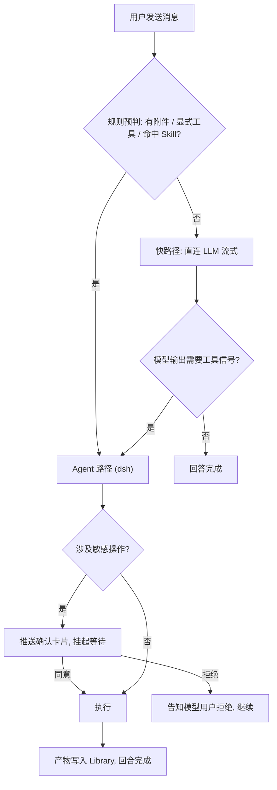
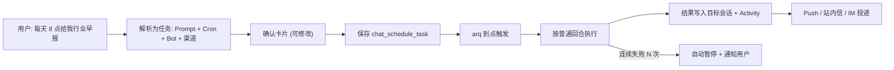
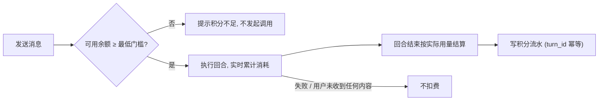

# 个人工作助手 —— 功能需求设计（查缺补漏版）

**日期：** 2026-11-17
**状态：** 草案 v3（D1–D11 均已确认）。仅设计，不开发
**前置文档：** [2026-11-16-personal-assistant-server-design.md](./2026-11-16-personal-assistant-server-design.md)（技术架构已定稿）

> 本文档聚焦"**做什么**"（功能边界、优先级、关键流程），不重复"**怎么做**"（架构/选型见前置文档）。
> 优先级定义：**P0** = MVP 必须；**P1** = 首个正式版；**P2** = 后续迭代。

---

## 1. 产品定位与角色

**一句话定位：** 一个对话里完成"问、查、写、算、做、记、提醒"的 **7×24 小时事件驱动型 AI 个人工作助手**——既支持随时主动对话，也能常驻监听定时、邮件、日程、网页监控等外部事件，异步执行并主动汇报结果，三端同步、产物自动沉淀。

| 角色 | 说明 | 核心诉求 |
|---|---|---|
| 个人用户（互联网） | 手机号注册的 C 端用户 | 好用、便宜、隐私可控 |
| 企业员工 | SSO 登录，归属某 `org` | 能连公司系统、数据不外泄 |
| 企业管理员 | 管理本组织成员/模型/Skills/配额 | 可控、可审计、可统计 |
| 平台运营 | 平台方运营与审核人员 | 内容合规、成本可控、数据看板 |

---

## 2. 现有设计已覆盖的能力（盘点）

| 已覆盖 | 完成度 | 备注 |
|---|---|---|
| 统一对话 + 快慢路由 | 架构清楚 | **路由判定规则与误判回退未定义**（见 3.2） |
| 多 Bot | 只有表名 | Bot 能配什么、能否分享未定义 |
| Library / Activity | 有分类 | 产物版本、编辑、删除联动未定义 |
| 会话管理 / 分享 | 有 | 分享权限粒度、失效、举报未定义 |
| 定时任务 | 有调度 | 创建方式（自然语言？表单？）、结果投递策略未定义 |
| 模型选择 | 有 | 计费倍率、能力标签未定义 |
| 用户上传 Skills | 有执行隔离 | 审核、版本、权限声明、密钥未定义 |
| 双用户体系 | 有 | 企业管理后台缺失 |
| 三端专属能力 | 有 | 本地目录挂载与"禁用宿主机工具"安全原则冲突（见 6） |

---

## 3. 缺口清单（查缺补漏）

### 3.1 产品功能缺口

| # | 缺口 | 为什么重要 | 建议 | 优先级 |
|---|---|---|---|---|
| G1 | **长期记忆 / 个性化** | "个人助手"区别于普通聊天机器人的核心；没有记忆就只是 ChatBot | 用户画像 + 自定义指令 + 可查看/编辑/删除的记忆条目 | P0（含自动记忆，见 D2） |
| G2 | **知识库 / 文件问答（RAG）** | 文档提过"个人云空间"，但没有检索能力，长文档、多文件问答无法支撑 | 个人知识库 + Bot 绑定知识库 + 引用溯源 | P0（单次上传问答）/ P1（持久知识库） |
| G3 | **待办 & 提醒** | 助手最高频场景之一；现只有 Cron 定时任务，粒度太重 | 对话中"明天 9 点提醒我…"自动生成提醒/待办，与定时任务共用调度 | P0 |
| G4 | **连接器（第三方授权）** | 工作助手必须能读邮件/日程/IM/文档 | OAuth 连接器中心：邮箱、日历、飞书/钉钉/企微、网盘；底层走 MCP | P1 |
| G5 | **人工确认（Human-in-the-loop）** | Agent 要发邮件、删文件、调用付费接口时必须用户确认 | 写操作/外发操作统一走"待确认卡片"，可设"本会话总是允许" | P0 |
| G6 | **长任务 / 深度研究** | 生 PPT、深度报告耗时分钟级，用户会离开 | 后台任务化：进度、取消、完成推送，结果回写会话 | P1 |
| G7 | **项目（Project）空间** | 分组只是文件夹，无法共享上下文 | 项目 = 一组会话 + 共享文件/指令/知识库 | P1 |
| G8 | **配额 / 计费 / 会员** | 17 万用户规模，成本必须可控；仅有 `user_quota` 表 | C 端免费积分（按模型倍率折算）+ 企业按组织采购分配；个人付费预留（见 D5/D8/D9） | P0（积分账户）/ P1（企业）/ P2（付费） |
| G9 | **管理后台** | 完全缺失；企业客户和运营都依赖 | 平台运营后台 + 企业管理后台两套视图 | P0（平台基础）/ P1（企业） |
| G10 | **隐私与数据权利** | 个保法要求：导出、注销、删除；"不用于训练"声明 | 设置页提供数据导出/删除/注销/记忆开关 | P0 |
| G11 | **全局搜索** | 会话、文件、产物多了之后找不到 | 统一搜索会话标题/内容、文件名、产物 | P1 |
| G12 | **通知渠道** | 只提到 App Push / 站内信 | 增加邮件、企微/飞书/钉钉机器人 Webhook 投递 | P1 |
| G13 | **生成类能力的功能边界** | 文档提到生图/生视频，但未列入功能 | 明确：图片生成 P1，视频生成 P2 | P1/P2 |
| G14 | **新手引导与模板** | 能力多但用户不知道能做什么 | 首页场景模板/推荐 Prompt/示例 Bot | P1 |
| G15 | **IM 渠道接入** | 企业用户习惯在飞书/企微里直接找助手 | 助手作为 IM 机器人，消息映射到同一会话体系 | P2 |

### 3.2 机制/规则缺口（不补会在开发时卡住）

| # | 缺口 | 需要明确的规则 |
|---|---|---|
| R1 | 快慢路由判定 | 判定依据（附件/命中 Skill/显式工具/意图分类器）；**快路径中途发现需要工具时如何升级**到 Agent（建议：快路径模型可输出"需要工具"信号→同回合无缝转交，前端不中断） |
| R2 | 上下文管理 | 快路径取多少轮历史、何时摘要压缩；快/慢两路如何共享同一份摘要 |
| R3 | 消息编辑与分支 | 编辑历史提问/重新生成后，是覆盖还是生成分支（建议：保留分支，可切换） |
| R4 | 多端并发 | 两端同时在同一会话发消息如何处理（建议：会话级串行锁，后发者排队或提示） |
| R5 | 定时任务结果投递 | 每次执行新建会话 or 追加到固定会话；失败重试次数、连续失败自动暂停 |
| R6 | 产物生命周期 | 删除会话是否删除产物；产物版本（同一 PPT 修改多次）；存储配额 |
| R7 | 删除语义 | 逻辑删除 + 回收站 N 天 + 物理清理；注销后数据保留期 |
| R8 | 模型降级 | 模型不可用/额度耗尽时自动切换哪个模型、是否告知用户 |
| R9 | Skill 权限声明 | Skill 需声明：是否联网、需要哪些密钥、可读哪些文件；运行时按声明授予 |
| R10 | 内容审核失败处理 | 输入拦截/输出中途拦截时前端展示与日志留存规则 |

---

## 4. 完整功能清单（按模块）

### M1 账号与身份
| 功能 | 优先级 |
|---|---|
| 手机号验证码登录 / 注册、微信登录（移动端） | P0 / P1 |
| 企业 SSO（OIDC/OAuth2）、组织与部门同步 | P1 / P1 |
| 多端登录设备管理、强制下线 | P1 |
| 账号注销（冷静期） | P0 |

### M2 统一对话
| 功能 | 优先级 |
|---|---|
| 流式输出、停止生成、重新生成、复制、点赞/点踩（带原因） | P0 |
| 思考过程展示（可折叠）、工具调用过程展示 | P0 |
| 附件上传（图片/PDF/Office/文本/表格），多模态理解 | P0 |
| 联网搜索 + 引用来源卡片 | P0 |
| 编辑历史提问 + 分支切换 | P1 |
| 会话新建/重命名/置顶/分组/删除/回收站 | P0 |
| 会话自动标题、自动摘要 | P0 |
| 断线续传 / 多端实时同步 | P0 |
| 语音输入、语音播报 | P1 |
| 引用某条消息/某个产物继续追问 | P1 |

### M3 Bot（智能体）
| 功能 | 优先级 |
|---|---|
| 默认全能助手 | P0 |
| 自建 Bot：名称、头像、人设指令、开场白、默认模型、启用的 Skills/工具、绑定知识库 | P1 |
| Bot 分享（链接/组织内）与复制 | P2 |
| 平台官方 Bot 广场 | P2 |

### M4 记忆与个性化（新增）
| 功能 | 优先级 |
|---|---|
| 自定义指令（"关于我"、"回答偏好"） | P0 |
| 自动记忆：对话中提取长期事实（需用户可见） | P0 |
| 记忆管理：查看、编辑、删除、全局开关、"临时对话"（不记忆不留存） | P0 |
| Bot 级独立记忆 | P2 |

### M5 文件与知识库（新增/补全）
| 功能 | 优先级 |
|---|---|
| 会话内文件解析问答（单次） | P0 |
| 个人文件空间：上传、预览、下载、删除、容量配额 | P1 |
| 知识库：建库、导入文件/网页、自动切分向量化、检索问答带引用 | P1 |
| 企业共享知识库（按组织/部门权限） | P2 |

### M6 工具与连接器（新增）
| 功能 | 优先级 |
|---|---|
| 内置工具：联网搜索、网页读取、代码执行、图表、Office 文档生成 | P0 |
| 图片生成 | P1 |
| 连接器中心（OAuth 授权）：邮箱、日历、飞书/钉钉/企微、网盘 | P1 |
| 用户自定义 MCP Server 接入 | P2 |
| 凭证保险箱（连接器 Token/Skill 密钥加密存储，可随时撤销） | P1 |

### M7 Skills
| 功能 | 优先级 |
|---|---|
| 内置技能库（平台维护） | P0 |
| 用户上传 Skill（`SKILL.md` + Python/JS），沙箱执行 | P1 |
| Skill 权限声明与运行时授权（R9） | P1 |
| Skill 版本管理、启用/禁用、调试运行日志 | P1 |
| 企业内 Skill 发布审核、Skill 市场 | P2 |
| 从对话"一键沉淀为 Skill" | P2 |

### M8 Agent 执行与人工确认（新增）
| 功能 | 优先级 |
|---|---|
| 敏感操作确认卡片（外发、删除、付费、写外部系统） | P0 |
| 任务计划展示（多步任务先列计划，可修改后执行） | P1 |
| 长任务后台化：进度条、取消、完成推送 | P1 |
| 执行失败的可读错误与"重试此步" | P1 |

### M9 Library（产物库）
| 功能 | 优先级 |
|---|---|
| All / Media / Files 分类、Today / This week / Older 分组 | P0 |
| 预览、下载、跳转来源会话 | P0 |
| 产物版本历史 | P1 |
| 在线编辑（文档/表格画布）后让 AI 继续修改 | P2 |

### M10 提醒、待办与定时任务（补全）
| 功能 | 优先级 |
|---|---|
| 自然语言创建提醒（一次性/重复） | P0 |
| 待办清单：AI 从对话/会议纪要提取待办，可勾选完成 | P1 |
| 定时任务：自然语言或表单创建，Prompt + Cron + 目标 Bot + 投递渠道 | P0 |
| 任务管理：暂停/恢复/立即执行/执行历史/连续失败自动暂停 | P0 |
| 条件触发（监控：如"网页内容变化时通知"） | P2 |

### M11 Activity 与通知
| 功能 | 优先级 |
|---|---|
| Activity 流：定时任务执行、长任务进度、系统通知 | P0 |
| 站内信 + App Push | P0 |
| 邮件、IM 机器人投递 | P1 |
| 通知偏好设置（免打扰时段、按类型开关） | P1 |

### M12 分享与协作
| 功能 | 优先级 |
|---|---|
| 会话分享快照（公开链接/仅组织内/密码/过期时间/随时撤销） | P0 |
| 他人从分享"继续对话"（复制到自己账号） | P1 |
| 分享内容举报与下架 | P0（互联网用户必须） |
| 项目空间多人协作 | P2 |

### M13 搜索
| 功能 | 优先级 |
|---|---|
| 会话标题搜索 | P0 |
| 全文搜索（会话内容 + 文件 + 产物） | P1 |

### M14 积分与计费（新增，D8/D9）
| 功能 | 优先级 |
|---|---|
| 积分账户 + 积分流水（所有消耗统一折算为积分，见 8.4） | P0 |
| 每日免费积分自动发放、余额不足提示、单条消息消耗展示 | P0 |
| 后台"积分规则"配置（免费额度、各类消耗单价；模型倍率在 M18 配置） | P0 |
| 用量明细（按日期/模型/功能） | P1 |
| 企业按组织采购、按部门/成员分配积分、超额策略 | P1 |
| 个人付费：套餐/充值/订单/支付回调/发票（**只预留数据模型，不开发**） | P2 |

### M15 设置与隐私（新增）
| 功能 | 优先级 |
|---|---|
| 语言、主题、默认模型、默认 Bot | P0 |
| 数据导出（会话/文件/记忆打包下载） | P0 |
| 清空历史、注销账号 | P0 |
| 临时对话（无痕模式） | P1 |

### M16 管理后台（新增）
| 视图 | 功能 | 优先级 |
|---|---|---|
| 平台运营 | 用户管理、封禁、**模型管理（见 M18）**、内置 Skill/Bot 管理 | P0 |
| 平台运营 | 内容审核队列（拦截记录、举报处理）、公告 | P0 |
| 平台运营 | 数据看板：DAU、会话数、Token 成本、模型分布、路由占比 | P1 |
| 企业管理员 | 成员与部门、可见模型、Skill 审核、额度分配 | P1 |
| 企业管理员 | 审计日志（谁在何时用了什么、外发了什么）、数据保留策略 | P1 |

### M17 安全与合规
| 功能 | 优先级 |
|---|---|
| 输入/输出内容审核（互联网用户强制） | P0 |
| AI 生成内容标识（深度合成规定） | P0 |
| 提示词注入防护：网页/文件/邮件内容作为"不可信数据"，不能触发敏感工具 | P0 |
| 敏感信息识别与脱敏（手机号/身份证/密钥） | P1 |
| 操作审计日志 | P0 |

### M18 后台 · 模型管理页（新增，P0，D11）

平台管理员在 Web 后台自行配置所有模型，**代码中不写死任何模型地址/Key/模型名**；PG 为唯一数据源，同步下发到 Higress AI 网关执行（见架构文档 8.2）。

**A. 供应商（Provider）**

| 字段 / 功能 | 说明 |
|---|---|
| 名称、类型 | 公有云 API / 自建 GPU（vLLM、SGLang）/ 其他 |
| 协议 | OpenAI 兼容（默认）、Anthropic 等，按协议选择适配器 |
| Base URL | 如 `https://api.deepseek.com/v1`、`http://10.0.0.5:8000/v1` |
| API Key 池 | 可配置多个 Key 轮询；**加密存储，保存后只显示掩码**，不回传前端、不写日志 |
| 超时、RPM / 并发上限 | 网关按此限流，超限自动切下一个 Key |
| 启用 / 停用、连通性测试 | 一键测试：返回延迟与可用模型列表（调用 `/models`） |

**B. 模型（Model）**

| 字段 / 功能 | 说明 |
|---|---|
| `model_code` | 业务唯一编码，会话、Bot、定时任务只引用它（换供应商时业务不受影响） |
| 上游模型名、所属供应商 | 如 `deepseek-chat`；同一 `model_code` 可配主备供应商 |
| 显示名、描述、图标、排序 | 用户端模型选择器展示 |
| 能力标签 | 视觉、工具调用、深度思考、长上下文——路由与前端按此判断能否传图/能否走 Agent |
| 上下文长度、最大输出 | 用于上下文裁剪与摘要触发 |
| 积分倍率 | 输入 / 缓存命中 / 输出三个倍率，用于折算积分（见 8.4） |
| 可见范围 | 全部用户 / 仅 C 端 / 指定组织 |
| 降级模型 | 不可用或限流时自动切换，前端提示"已切换到 xxx" |
| 状态 | 上线 / 灰度（按用户比例）/ 下线 |
| 在线试聊 | 后台直接发一条消息验证效果 |

**C. 系统用途绑定**（每个用途指定一个 `model_code`）

快路径默认对话、Agent 回合默认、会话标题与摘要、**记忆提取**、路由意图判定、Embedding（记忆/知识库向量）、多模态识别、内容审核（如用模型审核）。

**D. 生效与治理**

- **热更新**：保存后由同步任务调用 Higress Console API 下发到 Higress AI 网关（xDS 动态生效，不重启、不断开进行中的流）；业务层模型缓存通过 Redis 发布订阅刷新。
- **下线保护**：下线模型时提示受影响的会话、Bot、定时任务数量；这些对象自动改用降级模型，不报错。
- **变更审计**：谁在何时改了哪个字段（Key 只记录"已变更"）。
- **监控**：按模型统计调用量、错误率、首字延迟、Token 消耗（P1）。

> 管理员账号单独登录（与 C 端账号分开）、强制二次验证；MVP 只需"超级管理员"一个角色，RBAC 放 V1。

---

## 5. 关键流程

### 5.1 一个回合的路由与升级

### 5.2 提醒 / 定时任务

---

## 6. 现有设计中的不一致 / 需修订点

| # | 问题 | 建议 |
|---|---|---|
| C1 | 文档宣称"不区分日常/工作"，但表清单仍有 `ai_mode`，文中多处使用"工作模式" | 删除 `ai_mode` 概念，统一叫"Agent 回合"；或将其改为"模型能力档位" |
| C2 | "个人云空间"、`user_file`、`session_artifact`、Library 关系不清 | 明确：`user_file` = 用户上传；`session_artifact` = AI 产出；Library 展示二者的并集视图 |
| C3 | 桌面端"本地目录挂载 + 本地 dsh"与"必须禁用宿主机工具"原则冲突 | 桌面本地执行属于**用户自己机器**的授权场景，单独定义权限模型（目录白名单 + 每次写操作确认），不复用服务端沙箱原则 |
| C4 | 定时任务"写入 Bot 对话"未说明写到哪个会话 | 见 R5，建议每个任务固定一个会话，按日期分段 |
| C5 | 17 万用户估算未包含 RAG 向量检索、记忆抽取的成本 | 补充 pgvector（或独立向量库）资源与异步抽取 Worker 估算 |
| C6 | 表清单缺少新增模块所需表 | 需补：`ai_provider`、`ai_provider_key`、`ai_model`（扩展字段）、`ai_model_binding`、`admin_user`、`user_memory`、`knowledge_base`、`kb_document`、`user_reminder`/`user_todo`、`connector_auth`、`credential_vault`、`bot_*`、`audit_log`、`notification`、`billing_*` |

---

## 7. 版本切分建议

| 阶段 | 目标 | 范围 |
|---|---|---|
| **MVP（P0）** | 能用、可控、合规（C 端） | 见 8.2 |
| **V1（P1）** | 好用、有粘性、可卖企业 | 见 8.2 |
| **V2（P2）** | 生态与协作 | Bot/Skill 市场、自定义 MCP、IM 渠道接入、视频生成、条件触发监控、多人协作、画布编辑 |

---

## 8. 决策记录（2026-11-17 已确认）

| # | 问题 | 结论 | 对范围的影响 |
|---|---|---|---|
| D1 | 首发用户群 | **互联网 C 端先行** | 内容审核、AI 标识、举报下架、隐私权利、手机号实名均为 P0；企业 SSO / 企业后台降为 P1 |
| D2 | 长期记忆 | **自动记忆进 MVP** | M4 自动记忆 + 记忆管理（查看/编辑/删除/开关/临时对话）全部升为 P0——C 端自动记忆必须同时给用户可控性，否则有隐私投诉风险 |
| D3 | 知识库 | 未单独选择，按 D2 推论：**MVP 仅会话内文件问答，持久知识库 V1** | 记忆检索需要向量能力，MVP 即引入 pgvector，V1 知识库复用 |
| D4 | 首批连接器 | **邮箱、日历**（V1） | 邮箱需同时支持 OAuth（Gmail/Outlook）与 IMAP 授权码（QQ/163 等国内邮箱）；日历优先 CalDAV + Outlook |
| D5 | 计费 | **企业按组织采购；首版不向个人收费**（D8 修订：以后可能对个人收费） | C 端首版只发免费积分；个人付费预留数据模型；企业积分分配 P1 |
| D6 | 用户 Skills 开放范围 | **所有用户** | 见 8.1 的安全前置条件 |
| D7 | 消息编辑 | **保留分支，可切换** | `chat_message` 需从 MVP 起带 `parent_id`（树结构），分支切换 UI 可 V1 再做 |

### 8.1 D6（Skills 对所有 C 端用户开放）的安全前置条件

C 端开放用户上传可执行脚本风险最高，以下为上线 Skills 前的**硬性条件**：

1. **私有默认**：上传的 Skill 默认仅自己可用；公开分享必须经过人工/自动审核。
2. **静态扫描**：上传时扫描依赖、危险调用（反弹 shell、挖矿特征、外联地址），不通过拒绝入库。
3. **沙箱从严**：默认无公网；需要联网必须在权限声明中写明域名白名单并由用户确认；CPU/内存/时长/产出文件大小强限制。
4. **SKILL.md 也是攻击面**：其中的指令视为不可信提示词，不能借此绕过敏感操作确认（M8）。
5. **额度计入**：沙箱执行时长计入用户免费额度，防止被当成免费算力。
6. **一键下架**：运营后台可全局禁用某 Skill 及其所有副本。

### 8.2 修订后的 MVP 范围

账号（手机号）+ 统一对话（联网/附件/快慢路由/消息树）+ 默认助手 + **自定义指令 + 自动记忆 + 记忆管理** + 提醒与定时任务 + Library + Activity + 分享（含举报）+ 积分账户与每日免费积分（含后台积分规则）+ 敏感操作确认 + 内容审核与 AI 标识 + 平台基础后台（含模型管理页 M18）+ 隐私权利（导出/删除/注销）。

**V1：** 自建 Bot、持久知识库、邮箱/日历连接器、用户 Skills（满足 8.1）、长任务、项目空间、全文搜索、企业 SSO 与企业后台、图片生成、分支切换 UI。

### 8.3 补充决策

| # | 问题 | 结论 |
|---|---|---|
| D8 | C 端以后是否收费 | ✅ **以后可能收费**：首版不做支付，但积分账户、积分流水、套餐、订单的数据模型现在就按"可收费"设计，后续接支付不改核心表 |
| D9 | 额度口径 | ✅ **按模型倍率折算成积分**，规则见 8.4 |
| D10 | 记忆提取的透明度 | ✅ 已确认：**每次写入记忆都在对话中提示"已记住：xxx"**，提示上可直接"撤销/编辑"。SSE 协议新增 `memory` 事件 |
| D11 | 模型地址在哪配置 | 平台模型由管理员在 Web 管理后台配置（见 M18）。桌面端个人供应商设置是 P0 当前首个开发与验收项，用户可从「设置 → 模型」配置并选用自己的模型。 |

### 8.3.1 桌面端个人供应商与模型（D11）

- 用户可新增、编辑和删除 OpenAI 兼容供应商，填写名称、API 根地址和供应商要求的 API Key。支持本机、私有 IP 和使用 HTTPS 的公网服务。
- 用户可在一个供应商下配置多个模型，通过获取模型列表选择或手动填写模型 ID，并在对话页切换使用。
- 桌面进程直接请求所选供应商。供应商和模型配置保存在本机，API Key 使用系统加密能力保存。
- 首轮验收覆盖应用启动、供应商和模型配置、收到对话回复，以及重启后的配置恢复。开发顺序见 [MVP 实施计划](../plans/2026-11-17-personal-assistant-mvp-plan.md#当前优先项桌面端个人供应商与模型)。

### 8.4 积分规则（D8 + D9）

**1. 计算公式**（单价与倍率全部在后台配置，下列数字只是示意）

$$
\text{模型积分} = \left\lceil \frac{\text{输入 Token} \times r_{in} + \text{缓存命中 Token} \times r_{cache} + \text{输出 Token} \times r_{out}}{1000} \right\rceil
$$

- `r_in / r_cache / r_out` 为每个模型的倍率（M18 配置），可按上游成本设定，例如轻量模型 1 / 0.1 / 2，旗舰思考模型 4 / 0.4 / 16。
- 思考（reasoning）Token 按输出计。
- **非模型消耗**也折算成积分：联网搜索按次、沙箱执行按秒、图片生成按张、ASR/TTS 按分钟，单价在"积分规则"页配置。

**2. 一个回合的总消耗** = 本回合内所有模型调用（含 Agent 多步调用、子 Agent）+ 工具消耗之和。系统后台调用（标题、摘要、记忆提取、路由判定）**不向用户扣费**，计入平台成本统计。

**3. 扣费流程**

- **不中途掐断**：余额在回合中途用完，允许本回合完成，余额可小幅为负（设上限），下一回合前拦截。
- **用户主动停止**：按已产生的实际用量扣。
- **定时任务**：执行前同样检查余额，不足则跳过并在 Activity 通知。

**4. 积分账户结构（为以后收费预留）**

| 积分来源（桶） | 有效期 | 扣减顺序 |
|---|---|---|
| 每日免费 | 当天有效，次日刷新、不累积 | 1 |
| 活动赠送 | 按活动设置 | 2（先到期先扣） |
| 企业分配（P1） | 按组织策略 | 3 |
| 付费购买（P2 预留） | 长期或按套餐 | 4 |

**5. 用户可见**：每条回复下可展开查看"本次消耗 N 积分"；设置页显示余额、今日已用、流水明细（P1）。

**6. 对应数据表**：`point_account`（账户与各桶余额）、`point_bucket`（来源、有效期）、`point_ledger`（流水，`turn_id` 唯一）、`point_rule`（非模型消耗单价、免费额度）；预留 `billing_plan`、`billing_order`、`billing_payment`。
