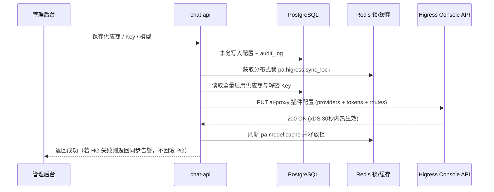

# Phase 1 · 数据库建表与管理后台 M18 设计文档

**日期：** 2026-11-17
**状态：** 设计定稿（暂不写代码）
**前置文档：**
- [2026-11-17-personal-assistant-data-model.md](./2026-11-17-personal-assistant-data-model.md)
- [2026-11-17-personal-assistant-api-contract.md](./2026-11-17-personal-assistant-api-contract.md)
- [2026-11-17-phase0-skeleton-and-env-design.md](./2026-11-17-phase0-skeleton-and-env-design.md)

---

## 1. 目标与边界

- **目标**：完成全部 PostgreSQL 16 + pgvector 数据库迁移脚本，并打通管理后台核心能力（管理员 2FA 登录、M18 模型与供应商管理、Higress 热同步、积分规则配置与审计日志）。
- **核心原则**：
  1. **PG 为唯一数据源**：所有模型地址、API Key、倍率、降级策略只以 PG 为准，Higress 只是配置执行端。
  2. **明文 Key 零暴露**：API Key 使用 `AES-256-GCM` 加密入库，接口只返回掩码（如 `sk-****9a21`），审计日志只记“Key 已更新”，不落明文。
  3. **配置不重启热生效**：后台修改后通过 Higress Console API 触发 xDS 动态下发，不重启网关、不断开正在进行的 SSE 流。

---

## 2. Alembic 迁移与分区落地

### 2.1 迁移结构（`services/chat-api/alembic/`）

- 使用异步 SQLAlchemy 引擎（`asyncpg`），通过 `alembic upgrade head` 一键建库。
- **`0001_initial_schema.py`**：
  1. 执行 `CREATE EXTENSION IF NOT EXISTS vector;`。
  2. 按依赖顺序创建全部核心表（用户与管理员、M18 模型、对话与消息树、记忆、文件/产物、定时任务、积分与预留计费、Skills/审核/审计）。
  3. **原生声明式分区初始化**：
     - `chat_session`（`PARTITION BY HASH (user_id)`）：创建 `chat_session_p0` ~ `chat_session_p15` 共 16 个子分区。
     - `chat_message`（`PARTITION BY RANGE (created_at)`）：初始化当月及未来 3 个月分区（例如 `chat_message_2026_11` ~ `chat_message_2027_02`）；后续由 `worker` 每月 25 日自动创建下下个月分区。
  4. **向量与查询索引**：
     - `user_memory`：`CREATE INDEX idx_user_memory_vec ON user_memory USING hnsw (embedding vector_cosine_ops);` + `(user_id, status)` 联合索引。
     - `point_ledger`：`UNIQUE (turn_id)` 保证按回合扣费幂等。
- **`0002_seed_defaults.py`**（幂等初始数据）：
  - 1 个初始超级管理员 `admin_user`（密码从环境变量读取，首次登录强制绑定 TOTP 2FA）；
  - 1 个平台默认全能助手 `ai_bot`（`is_builtin = true`）；
  - 4 条默认 `point_rule`：`daily_free_amount=1000`、`search_cost=2`、`sandbox_10s_cost=1`、`image_cost=15`。

---

## 3. 管理员认证与审计（`/api/admin/auth/*`）

1. **双密钥隔离**：管理后台只认 `ADMIN_JWT_SECRET` 签发的 `admin_jwt`，C 端 `user_jwt` 访问 `/api/admin/**` 直接返回 `4010`。
2. **强制 2FA 登录流程**：
   - `POST /api/admin/auth/login` 校验用户名密码；
   - 若尚未绑定 TOTP，返回 `requireTotpSetup: true` + 临时 `setupToken` 与 `otpauth://` 二维码串，调用 `/api/admin/auth/bindTotp` 完成绑定；
   - 已绑定用户必须带 6 位 `totpCode` 登录，校验通过签发 `admin_jwt`。
3. **操作审计中间件**：所有 `/api/admin/**` 的 `POST / PUT / DELETE` 请求自动写 `audit_log`（记录 `admin_id`、`action`、`target_type`、`target_id`、脱敏后的 `diff_json`）。

---

## 4. M18 模型管理详细设计

### 4.1 供应商与 Key 池

- **加密存储**：`pa_shared.security` 提供 `encrypt_secret(plain, master_key)` 与 `mask_secret(plain)`；每个供应商可挂载多个 `ai_provider_key` 实现轮询与权重分配。
- **连通性测试（`POST /api/admin/provider/{id}/test`）**：
  - 服务端解密主 Key，用 `httpx` 请求 `{base_url}/models`（超时 5s）；
  - 返回 `{ latencyMs, availableModels: [...] }`，并更新 Key 的健康状态，不暴露 Key 明文。

### 4.2 模型目录、下线保护与在线试聊

- **业务编码解耦**：`ai_model.model_code` 全局唯一（如 `ds-r1`、`ds-v3`），会话、Bot、定时任务、用途绑定只引用 `model_code`，换供应商时上游模型名 `upstream_model` 可改而业务无感。
- **三倍率配置**：`rate_in`、`rate_cache`、`rate_out`（`NUMERIC(8,4)`），供 Phase 3 积分结算读取。
- **下线保护（`GET /api/admin/model/{code}/impact`）**：
  - 统计近 30 天活跃 `chat_session`、未删除 `ai_bot`、活跃 `chat_schedule_task` 及 `ai_model_binding` 中引用该 `model_code` 的数量；
  - 若有活跃引用且未配置 `fallback_model_code`，禁止下线（返回 `4001` 提示先指定降级模型）。
- **在线试聊（`POST /api/admin/model/testChat`）**：
  - 后台管理员输入一条测试文本，服务端构造 `/v1/chat/completions` 请求**经 Higress AI 网关**发往目标模型；
  - 返回首字延迟（TTFT）、回复文本与 `usage` token 数，验证“后台配置 → Higress → 上游模型”全链路真实可用。

### 4.3 系统用途绑定

- `GET / PUT /api/admin/model/bindings` 管理 7 类系统内部用途：`fast_chat`、`agent_chat`、`summary`、`memory_extract`、`router`、`vision`、`moderation`。
- 更新后同步刷新 Redis 键 `pa:model:bindings`（无过期时间，每次更新覆盖），供 `chat-stream` 与 `worker` 毫秒级读取。

---

## 5. Higress AI 网关热同步（`HigressSyncService`）

- **同步失败兜底**：PG 事务提交后若 Higress 暂不可达，接口返回 `syncStatus: "pending_retry"`，由 `worker` 定时重试直至一致；后台顶部展示“网关配置待同步”提示与手动“立即下发”按钮。

---

## 6. Phase 1 验收标准

1. **数据库**：`alembic upgrade head` 执行成功；`chat_session` 16 个 HASH 分区、`chat_message` 当月及未来 3 个月 RANGE 分区、`user_memory` HNSW 索引与初始 Seed 数据全部就绪。
2. **后台鉴权**：使用初始管理员账号 + TOTP 2FA 登录成功；用 C 端 JWT 访问 `/api/admin/**` 返回 `4010`。
3. **M18 全链路**：
   - 在后台新增一个供应商并加密保存 API Key，接口返回列表只含掩码；
   - 点击「测试连通性」成功返回延迟与模型列表；
   - 新增模型 `ds-v3` 并配置三倍率，触发 Higress 同步成功；
   - 调用「在线试聊」经 Higress 成功拿到模型回复；
   - 查询 `audit_log` 能看到完整变更记录且无任何明文 Key。
4. **积分规则**：`GET / PUT /api/admin/points/rules` 读写正常。
