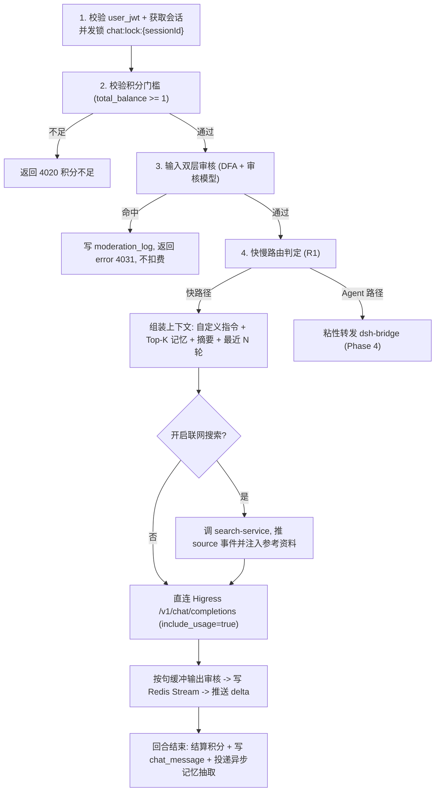

# Phase 3 · 快路径流式、内容审核、搜索与自动记忆设计文档

**日期：** 2026-11-17
**状态：** 后端已实现，待真实环境联调
**前置文档：**
- [2026-11-17-personal-assistant-api-contract.md](./2026-11-17-personal-assistant-api-contract.md)
- [2026-11-17-phase2-auth-points-session-design.md](./2026-11-17-phase2-auth-points-session-design.md)

---

## 1. 目标与边界

- **目标**：打通 ~85% 流量的**快路径端到端流式对话**、**双层内容审核**、**联网搜索（博查/Tavily）**、**Redis Stream 断线续传**、**按回合积分结算**以及 **自动记忆提取与撤销**。
- **性能硬约束**：`chat-stream` 进程不引入 SQLAlchemy/ORM，只用 `httpx` 调 `chat-api`（或轻量内网接口）与 Higress，自身仅维护 Redis 连接与流式转发。

---

## 2. 回合执行主链路（`POST /api/chat/stream/send`）

### 2.1 会话并发锁与停止生成

- **并发锁**：`SET chat:lock:{sessionId} {turnId} NX EX 120`；同一用户两端同时发消息时，后发请求返回 `4091`，防止消息树分叉错乱。
- **停止生成（`POST /api/chat/stream/stop`）**：向 Redis Pub/Sub 频道 `chat:ctrl:{turnId}` 发布 `stop`；`chat-stream` 立即中断上游 `httpx` 流，按上游已返回的 `usage`（若未返回则按已吐出字符数估算）结算积分，消息状态置 `stopped`。

### 2.2 快慢路由判定（R1）

1. **前置规则**：带附件（`fileIds` 非空）、用户显式选中 Skill/工具、或命中“生成图表/PPT/定时任务/分析文件”强意图 → 直接进 `dsh-bridge`（Phase 4）。
2. **中途升级（无缝转交）**：快路径携带一个轻量工具探测指令；若模型首段输出显式发出“需要执行工具/定时任务”信号，`chat-stream` 在**同一回合、同一 SSE 连接内**把上下文转交给 `dsh-bridge` 继续，前端无感。

---

## 3. 双层内容审核（`chat-stream` 单点拦截）

1. **第一层（毫秒级）**：内存 AC 自动机敏感词库（支持后台热更新 Redis 通知重载）+ 常见高危正则。命中高危直接拦截。
2. **第二层（语义审核模型）**：调用 `ai_model_binding.moderation` 绑定的自建审核模型（如微调 Qwen3Guard，经 Higress 调用）。
3. **流式输出按句缓冲**：
   - 缓冲窗口按中文句号/问号/感叹号/换行切句（或满 40 字强制送检），在吐给用户前过第一层 DFA（高危词逐句送第二层）；
   - 一旦输出中途拦截：立即中止流、向前端推送 `error (4031)`，替换/遮蔽当前回答，写入 `moderation_log`（进入后台复审队列）。
4. **AI 生成标识**：`meta` 与 `done` 事件附带合规标识字段，前端在回复底部或分享页展示“内容由 AI 生成”。

---

## 4. `search-service` 联网搜索

- **独立轻量服务（端口 `8102`）**：暴露 `POST /internal/search`。
- **路由与降级**：默认按 query 语言判断——含中文字符走**博查 API**，纯英文/海外词走**Tavily API**；任一供应商超时（> 4s）或报错自动切到另一家。
- **缓存与计费**：结果按 `search:cache:{sha256(query)}` 缓存 15 分钟；命中缓存仍记 1 次搜索工具调用（或按后台规则决定是否扣费），返回统一格式注入 `source` 事件。

---

## 5. Redis Stream 断线续传

- 每生成一个标准 SSE 帧，先 `XADD chat:stream:{sessionId} MAXLEN ~500 * event <type> data <json>`，并设置 `EXPIRE 600`。
- 客户端重连或切到另一端时，调用 `GET /api/chat/stream/resume?sessionId=&lastEventId=`：
  - 先用 `XREAD` 补发 `lastEventId` 之后的所有历史帧；
  - 若该回合尚未 `done`，继续阻塞读取新增帧直到 `done` / `error` 为止。

---

## 6. 自动记忆检索与异步提取（D2 / D10）

1. **对话前检索**：
   - 将当前用户提问用 `ai_model_binding.embedding` 向量化，在 `user_memory`（`status = 'active'`）中按余弦相似度取 Top-5 注入系统提示；
   - **临时对话（`isTemporary = true`）**：跳过记忆写入，且可按用户设置决定是否读取。
2. **对话后异步提取（`worker`）**：
   - 非临时对话回合结束后，`chat-stream` 向 `arq` 投递 `extract_memory_task(user_id, session_id, turn_id, user_msg, assistant_msg)`；
   - `worker` 调用 `memory_extract` 模型判断是否有值得长期记住的新事实（如职业、城市、偏好）；
   - 若有新记忆：去重/合并后写入 `user_memory`（`status = 'active'`）并向量化，通过 Redis Pub/Sub 通知 `chat-stream` 向当前连接补推一条 `memory` 事件（前端展示“已记住：xxx”及 编辑/撤销 按钮）。
   - 系统后台调用（记忆提取、标题生成、摘要）**不向用户扣积分**。

---

## 7. Phase 3 验收标准

1. **流式与续传**：普通问答首字延迟稳定；生成中途断网，调用 `/resume?lastEventId=...` 能无遗漏补齐剩余内容。
2. **审核拦截**：输入/输出触发敏感词或审核模型时立即拦截并返回 `4031`，`moderation_log` 入库且不扣用户积分。
3. **搜索与记忆**：提问实时新闻能返回 `source` 引用卡片；告知“我在上海做产品经理”后，触发 `memory` 事件弹出提示，点「撤销」后下轮对话不再注入该记忆。
4. **积分结算**：关闭/停止生成按实际用量扣费，失败不扣费，`point_ledger` 与 `usage` 对账一致。
